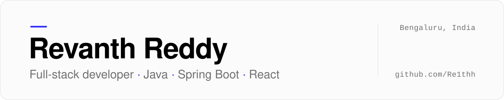

<picture>
  <source media="(prefers-color-scheme: dark)" srcset="./assets/header-dark.svg" />
  <source media="(prefers-color-scheme: light)" srcset="./assets/header-light.svg" />
  
</picture>

I'm Revanth, an Associate Software Developer at Mercedes-Benz Research and Development India in Bengaluru. I build full-stack web applications with Java and Spring Boot on the backend and React and TypeScript on the frontend. I'm open to Full-Stack Developer, Software Engineer and Java Full-Stack roles.

### Selected work

<!-- One-liners: edit the description text in each row below. -->

| Project | What it is |
| --- | --- |
| [**FoodRecipeApp**](https://github.com/Re1thh/FoodRecipeApp) | Recipe search page that queries the Edamam API and shows results as cards. Built in 2023 while learning React. React · JavaScript · Tailwind |
| [**bankLoan**](https://github.com/Re1thh/bankLoan) | Spring Boot REST API training exercise for sanctioning home and car loans and reporting loans by type. Java · Spring Boot · JPA · Maven |
| [**formvalidation**](https://github.com/Re1thh/formvalidation) | Small form validated with React Hook Form and Yup, built as a React and TypeScript exercise. React · TypeScript · React Hook Form · Yup |

### Currently exploring

Open-source projects I've forked to read and learn from. These are not my own work; credit goes to the upstream authors.

- [**ta4j**](https://github.com/Re1thh/ta4j), by ta4j/ta4j: a Java technical-analysis library. Studying its indicator and backtesting API design.
- [**lightweight-charts**](https://github.com/Re1thh/lightweight-charts), by tradingview: a charting library. Studying its canvas rendering and TypeScript API.
- [**realworld-springboot-java**](https://github.com/Re1thh/realworld-springboot-java), by raeperd: a Spring Boot RealWorld backend. Studying its layering, security setup and tests.
- [**spring-petclinic-microservices**](https://github.com/Re1thh/spring-petclinic-microservices), by spring-petclinic: Spring Cloud microservices. Studying service discovery, config and gateway patterns.
- [**local-deep-researcher**](https://github.com/Re1thh/local-deep-researcher), by langchain-ai: a local LLM research agent. Studying how the agent loop is structured.
- [**evidence**](https://github.com/Re1thh/evidence), by evidence-dev: BI as code. Studying its SQL-plus-Markdown reporting model.
- [**bulletproof-react**](https://github.com/Re1thh/bulletproof-react), by alan2207: React architecture. Studying feature-based project structure.
- [**DevOps-Projects**](https://github.com/Re1thh/DevOps-Projects), by NotHarshhaa: a collection of DevOps projects. Studying CI/CD and deployment workflows.

### Stack

### Activity

<picture>
  <source media="(prefers-color-scheme: dark)" srcset="https://raw.githubusercontent.com/Re1thh/Re1thh/output/snake-dark.svg" />
  <source media="(prefers-color-scheme: light)" srcset="https://raw.githubusercontent.com/Re1thh/Re1thh/output/snake.svg" />
  
</picture>

### Contact

